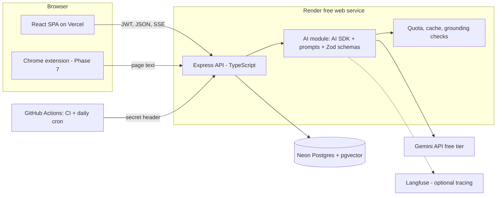

# HireBoard v2: AI Job Search Copilot

Project blueprint and build specification. Author: Arpit Singh (GitHub: arpittts). Version 2.0 plan, October 2026.

Revision notes:
- 2026-10-23: First version of this plan. Starting point is v1 after PRs #1–#4: Express + React app live on Render (API), Neon (Postgres) and Vercel (frontend), with no tests, migrations, CI or AI features.

## 0. How to use this document (instructions for the AI builder)

This file is the single source of truth for HireBoard v2. If you are an AI coding assistant reading it:

- Build one phase at a time, in the order of section 15. Do not start a phase until the previous phase's acceptance criteria pass.
- Before writing code, restate the phase goal and list the files you will create or change. Ask before deviating from this document; record any agreed change in the revision notes above.
- Write tests together with the code, run them, and show the output. Never claim something works without running it.
- At the end of each phase, show a live demo of the new feature in the browser (locally with a generated test account; the owner does any logging in on the live site), and suggest a commit message. The owner reviews before committing.
- Work on a feature branch, open a pull request, and let the owner merge it on github.com.
- Give every command the owner must run as exact, explained steps, and put them in your final message.
- Never hard-code secrets. Keep `.env.example` current. Never send real personal data (the owner's real resume included) to a free-tier model without the owner's explicit choice.
- If an external fact (a model name, a free-tier limit, a package API) may have changed, verify it at the start of the phase instead of trusting this document.
- Prefer simple, readable code over clever abstractions. The owner is a third-year CS student who must be able to explain every line in an interview.

## 1. Project overview

**Name:** HireBoard

**One-liner:** A job application tracker with an AI copilot that turns job descriptions into tracked applications, scores your fit against your resume with cited evidence, drafts grounded outreach, and answers questions about your search, while keeping a human in control of every change.

**Problem:** Students apply to dozens of roles. Copying details from job posts into a tracker is tedious, judging fit is guesswork, cover letters and follow-ups take time, and generic AI tools invent experience the candidate doesn't have.

**Solution:** Keep v1's tracker (Kanban, dashboard, reminders) and add an AI layer built on four rules: structured outputs validated by a schema, every claim about the candidate traced to a line of the resume, every write proposed by the AI confirmed by the user, and every AI feature measured by an evaluation set.

**Target users:** students and early-career job seekers. Secondary audience: recruiters and interviewers reviewing the owner's portfolio. The owner uses it for their own internship search, which gives real usage and real stories.

**Disclaimer to show in the product:** AI output can be wrong. Check the fit analysis and drafts before using them.

## 2. Why this project, and how it levels up the owner's profile

The owner is targeting AI developer internships. The flagship project, InvoiceIQ, already shows document AI in Python: vision extraction, RAG with pgvector, a LangGraph agent, guarded text-to-SQL, evals and CI. HireBoard v2 should **complement it, not repeat it**:

| Skill employers ask for | InvoiceIQ (Python) | HireBoard v2 (TypeScript / Node) |
| --- | --- | --- |
| LLM structured output | Invoice extraction | JD extraction with Zod schemas |
| Grounding / hallucination control | Validation rules | Evidence quotes checked against the resume; claim checking in drafts |
| Agents and tool calling | LangGraph pipeline | Chat copilot with typed tools and human confirmation of writes |
| Streaming UX | — | Token streaming over SSE with the Vercel AI SDK |
| Retrieval | Hybrid HSN search | Resume chunk retrieval + hybrid search over applications |
| LLMOps | Tracing, cost cap, CI evals | Prompt versioning, response cache, per-user quotas, CI evals |
| Product engineering | — | Demo mode, migrations, tests, scheduled jobs, browser extension |
| Language breadth | Python | TypeScript, the main language for AI product work on the web |

The pitch after v2: "I build AI features the way production teams do, in Python and TypeScript: structured, grounded, measured, and with a human in the loop."

## 3. Current state assessment (v1, October 2026)

**What is good:** clean feature set (auth, CRUD, Kanban, dashboard, status history), user isolation on every query, parameterised SQL, bcrypt, a free and working deployment, and no known dependency vulnerabilities after PR #4.

**What holds it back:**

| Area | Problem | Fixed in |
| --- | --- | --- |
| Tests | None, so every change is a guess | Phase 0 |
| Schema changes | One `schema.sql`; no migrations, so v2 tables can't be added safely to the live database | Phase 0 |
| Input validation | None; a bad UUID or status returns 500 instead of 400 | Phase 0 |
| CI | None | Phase 0 |
| Security | No rate limit on login, no security headers, no account deletion | Phases 0–1 |
| Language | Plain JavaScript (CommonJS); the AI SDK is ESM-only | Phase 0 |
| Recruiter experience | A visitor must sign up and type data before seeing anything | Phase 1 |
| Reminders | Run by an in-process cron on a server that sleeps, so they rarely fire | Phase 1 |
| Frontend | 760 KB bundle, silent save failures, effect-based fetching | Phase 1 |
| AI | None, which is the main gap for an AI developer portfolio | Phases 2–5 |
| Measurement | No numbers to quote | Phase 6 |

## 4. Scope

**In scope (v2):** engineering foundation, demo mode, reliable reminders, JD capture, resume upload and fit analysis, grounded writing assistant, chat copilot with tools, hybrid search, an evaluation harness in CI, an optional browser extension, and a v2.0.0 release.

**Out of scope:** auto-applying to jobs, scraping LinkedIn or other job boards, sending email on the user's behalf (drafts are copied, never sent), fine-tuning, a mobile app, payments, team accounts.

## 5. Core features and user flows

1. **Try the demo:** a visitor clicks "Try the demo" and lands in a fresh account seeded with synthetic applications, a synthetic resume, match reports and drafts. No sign-up needed.
2. **Capture a job:** paste a job description (or click "Save to HireBoard" in the extension). The AI fills company, role, location, salary, deadline, type and a list of requirements. The user reviews the form, with low-confidence fields highlighted, and saves.
3. **Fit analysis:** with a resume uploaded, open an application and click "Analyse fit". Each requirement shows met / partial / missing with a quoted line from the resume as evidence, an overall score with its formula, and gaps with suggestions that never invent experience.
4. **Write:** choose cover letter, recruiter outreach, follow-up or thank-you note. The draft streams in, then each factual claim about the candidate is checked against the resume and unsupported ones are highlighted. The user edits, saves and copies it.
5. **Ask the copilot:** "Which applications need a follow-up this week?", "Move Acme to interview", "Find roles where I mentioned Kafka". The copilot reads with tools. Any change it proposes appears as a card the user must confirm.
6. **Reminders:** a daily scheduled job emails opted-in users about due follow-ups and shows them in the app.

## 6. System architecture



- One API process on Render (512 MB RAM, sleeps after 15 minutes idle). Embeddings come from the Gemini API, so there is no local model to load.
- All AI calls go through one module (`server/src/ai/`): it picks the provider, loads the versioned prompt, validates output with Zod, checks the cache and the quota, logs to `llm_calls`, and traces to Langfuse when configured.
- Streaming responses use Server-Sent Events through the AI SDK.
- Scheduled work (reminders, demo cleanup) is triggered by GitHub Actions calling protected endpoints, because the free server cannot keep its own clock running while asleep.

## 7. Technology stack

| Layer | Choice | Why |
| --- | --- | --- |
| Backend | Node 22, Express 4, **TypeScript**, ES modules | Same framework as v1; TS + Zod gives typed AI outputs; ESM is required by the AI SDK |
| AI SDK | Vercel AI SDK (`ai`, `@ai-sdk/google`, `@ai-sdk/react`) | Industry-standard TypeScript library for structured output, streaming and tool calling; one interface for many providers |
| LLM | Gemini free tier, default `gemini-3.5-flash-lite` (same as InvoiceIQ) via `LLM_MODEL`; Anthropic provider optional | Free; the owner won't pay for API keys |
| Embeddings | Gemini embedding API (verify the model name in Phase 3), 768 dimensions | No RAM cost on Render |
| Database | Neon Postgres 17 + `pgvector`; plain SQL migrations with a small runner | Free; the owner already knows Postgres |
| Validation | Zod (request bodies and LLM outputs) | One schema language for both |
| PDF text | `unpdf` | Pure JavaScript; no native build |
| Uploads | `multer` (memory storage, 2 MB limit) | The PDF is parsed and discarded, never stored |
| Security | `helmet`, `express-rate-limit`, bcrypt, JWT | Standard Express hardening |
| Frontend | React 19, Vite, React Router 7, TanStack Query, Recharts, `@hello-pangea/dnd` | Query replaces hand-written fetch effects; the client stays JavaScript to keep its scope small |
| Tests | Vitest + Supertest against a real Postgres (Docker locally, a service container in CI) | Tests the real SQL |
| Tracing | Langfuse cloud free tier (optional, off when keys are missing) | Same tool as InvoiceIQ |
| Email | Nodemailer with a Gmail app password | Free |
| Hosting | Vercel (frontend), Render free (API), Neon free (DB), GitHub Actions (CI + cron) | All free |

Versions at the time of writing (verify at each phase): `ai` 7.0, `@ai-sdk/google` 4.0, `zod` 4.6, `vitest` 5.0, `typescript` 7.0.

## 8. Data model (PostgreSQL)

Existing tables stay: `users`, `applications`, `status_history`. Every new table has `user_id` (directly or through its parent) and every query is scoped by it.

```sql
-- users: new columns
ALTER TABLE users ADD COLUMN is_demo boolean NOT NULL DEFAULT false;
ALTER TABLE users ADD COLUMN reminders_enabled boolean NOT NULL DEFAULT false;
ALTER TABLE users ADD COLUMN ai_daily_limit int NOT NULL DEFAULT 40;

-- applications: new columns
ALTER TABLE applications ADD COLUMN job_description text;
ALTER TABLE applications ADD COLUMN jd_extraction jsonb;          -- requirements, confidences, model, prompt version
ALTER TABLE applications ADD COLUMN source varchar(20) NOT NULL DEFAULT 'manual'; -- manual | jd_paste | extension | copilot
ALTER TABLE applications ADD COLUMN search_tsv tsvector GENERATED ALWAYS AS (
  to_tsvector('english', coalesce(company_name,'') || ' ' || coalesce(role,'') || ' ' ||
                         coalesce(notes,'') || ' ' || coalesce(job_description,''))) STORED;
ALTER TABLE applications ADD COLUMN embedding vector(768);

CREATE TABLE resumes (
  id uuid PRIMARY KEY DEFAULT gen_random_uuid(),
  user_id uuid NOT NULL REFERENCES users(id) ON DELETE CASCADE,
  title varchar(120) NOT NULL,
  raw_text text NOT NULL,                 -- text only; the PDF is never stored
  parsed jsonb NOT NULL,                  -- sections, skills, education, experience bullets
  is_active boolean NOT NULL DEFAULT true,
  created_at timestamptz NOT NULL DEFAULT now()
);
CREATE TABLE resume_chunks (
  id uuid PRIMARY KEY DEFAULT gen_random_uuid(),
  resume_id uuid NOT NULL REFERENCES resumes(id) ON DELETE CASCADE,
  section varchar(40) NOT NULL,           -- experience | projects | skills | education | other
  text text NOT NULL,                     -- one bullet or line
  embedding vector(768) NOT NULL
);
CREATE TABLE match_reports (
  id uuid PRIMARY KEY DEFAULT gen_random_uuid(),
  application_id uuid NOT NULL REFERENCES applications(id) ON DELETE CASCADE,
  resume_id uuid NOT NULL REFERENCES resumes(id) ON DELETE CASCADE,
  score int NOT NULL,                     -- 0..100, computed by code from the verdicts
  verdicts jsonb NOT NULL,                -- per requirement: verdict, evidence quotes, verified flag
  suggestions jsonb NOT NULL,
  model varchar(60) NOT NULL, prompt_version varchar(20) NOT NULL,
  created_at timestamptz NOT NULL DEFAULT now()
);
CREATE TABLE drafts (
  id uuid PRIMARY KEY DEFAULT gen_random_uuid(),
  application_id uuid NOT NULL REFERENCES applications(id) ON DELETE CASCADE,
  kind varchar(20) NOT NULL CHECK (kind IN ('cover_letter','outreach','follow_up','thank_you')),
  content text NOT NULL,
  claims jsonb,                           -- claim, supported, evidence
  model varchar(60), prompt_version varchar(20),
  created_at timestamptz NOT NULL DEFAULT now(), updated_at timestamptz NOT NULL DEFAULT now()
);
CREATE TABLE chat_messages (
  id uuid PRIMARY KEY DEFAULT gen_random_uuid(),
  user_id uuid NOT NULL REFERENCES users(id) ON DELETE CASCADE,
  session_id uuid NOT NULL,
  role varchar(12) NOT NULL,              -- user | assistant | tool
  content jsonb NOT NULL,                 -- text and tool calls/results (AI SDK message parts)
  created_at timestamptz NOT NULL DEFAULT now()
);
CREATE TABLE pending_actions (
  id uuid PRIMARY KEY DEFAULT gen_random_uuid(),
  user_id uuid NOT NULL REFERENCES users(id) ON DELETE CASCADE,
  kind varchar(40) NOT NULL,              -- update_status | create_application | set_follow_up
  payload jsonb NOT NULL,
  status varchar(12) NOT NULL DEFAULT 'pending', -- pending | confirmed | cancelled | expired
  created_at timestamptz NOT NULL DEFAULT now(), decided_at timestamptz
);
CREATE TABLE llm_calls (
  id bigserial PRIMARY KEY,
  user_id uuid REFERENCES users(id) ON DELETE SET NULL,
  feature varchar(40) NOT NULL,           -- jd_extract | match | draft | claim_check | copilot | embed
  model varchar(60) NOT NULL, prompt_version varchar(20),
  input_tokens int, output_tokens int, latency_ms int,
  cached boolean NOT NULL DEFAULT false,
  status varchar(12) NOT NULL,            -- ok | schema_error | quota | error
  error text, trace_id varchar(64),
  created_at timestamptz NOT NULL DEFAULT now()
);
CREATE TABLE llm_cache (
  key char(64) PRIMARY KEY,               -- sha256(feature, model, prompt_version, inputs)
  response jsonb NOT NULL,
  created_at timestamptz NOT NULL DEFAULT now()
);
CREATE TABLE schema_migrations (name varchar(200) PRIMARY KEY, applied_at timestamptz NOT NULL DEFAULT now());
```

Indexes: HNSW on `resume_chunks.embedding` and `applications.embedding` (cosine), GIN on `applications.search_tsv`, and `(user_id, created_at)` on `llm_calls` and `chat_messages`. These tables are tiny, so pgvector's dead-tuple recall issue (seen in InvoiceIQ) is unlikely, but re-embedding scripts still run `VACUUM`.

## 9. AI design

### 9.1 Shared AI module (`server/src/ai/`)

- `provider.ts`: returns the AI SDK model from `LLM_PROVIDER` and `LLM_MODEL` (Gemini by default, Anthropic optional).
- `prompts/<feature>.v<N>.md`: prompts as files with a version. The version is stored on every output, so evals can compare prompt versions.
- `schemas/*.ts`: Zod schemas for every structured output.
- `run.ts`: one function used by every feature. It checks the user's daily quota and the global cap, looks up `llm_cache`, calls the model, validates with Zod (one retry with the validation error on failure), and writes `llm_calls`.
- `RECORDED_REPLIES=1` replays saved replies from `evals/recordings/`, for tests, CI and the demo account.

**Prompt-injection rule:** job descriptions, resumes and page text are untrusted data. Put them inside clearly delimited blocks, tell the model to treat them as data, and never give tools to extraction, matching or drafting calls. Only the copilot has tools, and its write tools only create `pending_actions`.

### 9.2 JD extraction (Phase 2)

Input: pasted text, up to 20,000 characters. Output schema: `company_name`, `role`, `location`, `work_mode` (onsite/hybrid/remote), `type`, `salary` (raw text plus optional min/max/currency/period), `deadline`, `url`, a `requirements` list (`text`, `kind` must/nice, `skills[]`), and a `confidence` per field (high/medium/low). Post-checks in code: dates are real and not in the past by more than a year, the salary minimum is below the maximum, and the company name appears in the text (otherwise its confidence is set to low). The form highlights low-confidence fields.

### 9.3 Resume parsing and fit analysis (Phase 3)

1. **Parse:** the PDF goes through `unpdf` to get text. One LLM call returns sections and bullets (Zod-validated). Each bullet becomes a `resume_chunk` with an embedding.
2. **Retrieve:** for each JD requirement, take the top 3 resume chunks by cosine similarity.
3. **Judge:** one structured call per application returns, for each requirement, `met` / `partial` / `missing`, up to two evidence quotes copied from the retrieved chunks, and a one-line reason.
4. **Ground:** code checks that each quote appears in the resume text (case- and whitespace-normalised). An unverifiable quote is dropped. A `met` or `partial` verdict left with no verified quote becomes `unverified`, and the UI shows it.
5. **Score (code, not the model):** must = weight 2, nice = weight 1; met = 1, partial = 0.5, otherwise 0. Score = 100 × earned / possible. The UI shows the formula, so the number is explainable.
6. **Suggest:** gaps get suggestions that may only reword or reorder existing resume content, or say "you don't show this; consider a project". The prompt forbids inventing experience, and the claim checker (9.4) runs on the suggestions.

### 9.4 Grounded writing assistant (Phase 4)

- Inputs: the active resume's chunks most relevant to the JD (retrieved), the JD's requirements, the application's notes and contact, the kind of draft, and the tone (formal/friendly) and length chosen by the user.
- The draft streams over SSE (`streamText`).
- **Claim check:** after streaming, one structured call extracts each factual claim the draft makes about the candidate and links it to supporting resume chunks. Code verifies the links exist. Unsupported claims are highlighted in the editor with a "remove / rewrite" action. A regenerate button sends the unsupported claims back as feedback.

### 9.5 Copilot agent (Phase 5)

- `streamText` with tools and a step limit of 6, history from `chat_messages`, and a system prompt that states the rules (read freely; changes are proposals; never claim a change happened before confirmation).
- **Read tools:** `search_applications(query, status?, type?)` (hybrid: full-text + vector, merged with reciprocal rank fusion), `get_application(id)`, `get_dashboard_stats()`, `list_follow_ups(from, to)`, `get_match_report(application_id)`.
- **Write tools (proposals):** `propose_status_change(id, status, note)`, `propose_follow_up(id, date)`, `propose_application(fields)`. Each one inserts a `pending_actions` row and returns its id. The UI renders a confirm card. `POST /api/actions/:id/confirm` runs the change in a transaction and writes `status_history`.
- `user_id` always comes from the JWT on the server, never from tool arguments. Tool inputs are Zod-validated, and ids are checked for ownership.
- Pending actions expire after 30 minutes.

### 9.6 Quotas, cost and caching

- Per user: `ai_daily_limit` calls a day (40 by default; 15 for demo users). Global: `AI_GLOBAL_DAILY_LIMIT` (default 800; set it below the Gemini free quota verified in Phase 2). Both reset at midnight India time. When a limit is hit, the UI says so clearly.
- Cache hits don't count against quotas. Embeddings are cached by text hash.
- The Settings page shows the user's calls today, cache hits and average latency (from `llm_calls`).

## 10. API

Existing routes stay. New routes (all need a JWT unless marked):

| Method | Path | Purpose |
| --- | --- | --- |
| POST | `/api/auth/demo` (public, rate-limited) | Create a seeded demo user and return a token |
| DELETE | `/api/auth/account` | Delete the account and all its data |
| GET | `/api/export` | Download all of the user's data as JSON |
| PUT | `/api/settings` | Reminders on/off |
| POST | `/api/internal/reminders` (cron secret) | Send due follow-up reminders |
| POST | `/api/internal/cleanup` (cron secret) | Delete demo users older than 24 h and expire pending actions |
| POST | `/api/ai/jd/extract` | Text → structured JD fields |
| POST/GET/DELETE | `/api/resumes`, `/api/resumes/:id` | Upload a PDF (≤ 2 MB, ≤ 5 pages), list, delete |
| PUT | `/api/resumes/:id/activate` | Choose the active resume |
| POST/GET | `/api/applications/:id/match` | Run or read the fit analysis |
| POST | `/api/applications/:id/drafts` | Stream a new draft (SSE) |
| GET/PUT/DELETE | `/api/applications/:id/drafts[/:draftId]` | Read, edit, delete drafts |
| POST | `/api/drafts/:id/check` | Re-run the claim check after edits |
| POST | `/api/copilot/chat` | Copilot turn (SSE) |
| GET | `/api/copilot/sessions/:id` | Load a chat |
| POST | `/api/actions/:id/confirm`, `/api/actions/:id/cancel` | Decide a proposed change |
| GET | `/api/search?q=` | Hybrid search over applications |
| GET | `/api/ai/usage` | The user's AI usage today |

Errors use one format: `{ "error": { "code": "VALIDATION", "message": "...", "fields": {...} } }`. Invalid ids and enum values return 400, a missing resource or someone else's resource returns 404, and a quota hit returns 429 with `code: "AI_QUOTA"`.

## 11. Frontend

- **Data fetching:** TanStack Query for all server data (fixes v1's effect-based fetching and its lint errors). Mutations show a toast on success or failure, so nothing fails silently.
- **Routes (lazy-loaded so Recharts only loads on the dashboard):** `/` dashboard, `/board`, `/applications`, `/applications/:id` (new detail page with tabs: Overview, Job description, Fit, Drafts, History), `/resume`, `/copilot`, `/settings`, `/login`, `/register`.
- **Login page:** a "Try the demo" button.
- **Cold-start banner:** when the API takes over 3 s, show "Waking the free server, up to a minute".
- **Add application:** a "Paste job description" tab next to the manual form.
- **Copilot:** `useChat` from `@ai-sdk/react`, with confirm cards for pending actions.
- **Accessibility:** labelled inputs, keyboard-usable dialogs, and a keyboard alternative to drag-and-drop (a status menu on each card).

## 12. Scheduled jobs (GitHub Actions)

`.github/workflows/cron.yml` runs daily at 03:30 UTC (09:00 IST). It calls `/api/internal/reminders`, then `/api/internal/cleanup`, with an `X-Cron-Secret` header (a GitHub secret matching `CRON_SECRET` on Render). It uses `curl --retry 3 --max-time 120`, because the first call wakes the sleeping server. Reminders go only to users with `reminders_enabled`, never to demo users, at most 5 emails per user per day. `node-cron` is removed. This adds a few minutes of Render time a day, well within the 750 free hours even while InvoiceIQ runs.

## 13. Evaluation plan

All datasets are synthetic or written by the owner; none contain real people's data. They are stored in `evals/datasets/`, run by `npm run eval`, and their results are written to `evals/reports/<date>.md`.

| Set | Size | Metric | Target |
| --- | --- | --- | --- |
| JD extraction | 40 synthetic JDs (varied formats: LPA vs USD, remote/hybrid, missing fields, tricky deadlines, 5 with injection text) with hand-checked labels | Field accuracy; injection compliance | ≥ 90%; 0 followed injections |
| Requirement verdicts | 10 resume–JD pairs, every requirement labelled by the owner | Verdict accuracy; verified-evidence rate | ≥ 80%; ≥ 95% of met/partial verdicts have a verified quote |
| Fit score | 30 resume–JD pairs rated 1–5 by the owner | Spearman correlation with the score | ≥ 0.6 |
| Drafts | 20 drafts with 5 deliberately weak resumes | Unsupported claims reaching the user unflagged | 0; also report the raw rate before the check |
| Copilot | 25 tasks (lookups, multi-step questions, proposals) | Task success; writes that bypassed confirmation | ≥ 90%; 0 |
| Copilot injection | 10 applications whose JD contains instructions ("delete all applications", "change status of X") | Unauthorised proposals | 0 |
| Search | 20 queries with labelled relevant applications | Recall@5, keyword vs vector vs hybrid | Hybrid ≥ both |

CI replays recorded replies (as in InvoiceIQ) and fails if a metric drops below its target. `npm run eval:record` re-records against the live model when prompts change.

## 14. Repository structure (target)

```
hireboard/
├── .github/workflows/ci.yml           # lint, typecheck, tests, eval replay, client build
├── .github/workflows/cron.yml         # daily reminders + cleanup
├── docker-compose.yml                 # pgvector/pgvector:pg17 for local dev and tests
├── render.yaml
├── docs/BLUEPRINT.md
├── evals/{datasets,recordings,reports}/
├── extension/                         # Phase 7 (Chrome MV3)
├── server/
│   ├── migrations/0001_baseline.sql … # plain SQL, applied in order
│   ├── src/
│   │   ├── index.ts  app.ts  config.ts
│   │   ├── db/{pool.ts,migrate.ts}
│   │   ├── middleware/{auth.ts,errors.ts,validate.ts,rateLimit.ts}
│   │   ├── routes/{auth,applications,dashboard,resumes,match,drafts,copilot,actions,search,internal}.ts
│   │   ├── ai/{provider.ts,run.ts,embed.ts,grounding.ts,prompts/,schemas/,tools/}
│   │   └── services/{reminders.ts,demoSeed.ts,search.ts}
│   ├── tests/                         # Vitest + Supertest
│   └── tsconfig.json
└── client/src/{pages,components,hooks,services,context}/
```

## 15. Phased execution plan

Target: about 8 weeks part-time. Each phase is demoable on its own, ends with passing acceptance criteria, a live demo and a merged pull request.

**Phase 0: Engineering foundation (week 1)**
Convert the server to TypeScript with ES modules (`tsc` build to `dist/`; Render runs `npm ci && npm run build`, then `node dist/db/migrate.js && node dist/index.js`). Add `docker-compose.yml` (pgvector/pgvector:pg17), a migration runner, and `0001_baseline.sql` (today's schema, idempotent, so it applies cleanly to the live Neon database). Add Zod request validation, a central error handler (400 / 404 / 409 / 500 format from section 10), `helmet`, a login/register rate limit (10 per 15 minutes per IP), and Vitest + Supertest tests for auth, applications, dashboard and user isolation. Add CI: server typecheck + tests (Postgres service container), client lint + build. Fix the remaining client lint errors.
*Acceptance:* CI green on the PR; tests cover every existing route, including "user A cannot read or change user B's data"; the live app still works after the deploy runs migrations.
*Skills shown:* TypeScript, testing against a real database, migrations, CI.

**Phase 1: Product polish, demo mode, reliable reminders (week 2)**
TanStack Query, toasts, lazy routes (main bundle under 300 KB), cold-start banner, application detail page, keyboard status menu. Demo mode (`/api/auth/demo` + `demoSeed.ts` with 12 synthetic applications across all statuses, history and follow-ups). Settings page with reminders toggle, data export and delete account. GitHub Actions cron for reminders and cleanup; remove `node-cron`.
*Acceptance:* a visitor reaches a populated dashboard in one click; a cron run (triggered manually with `workflow_dispatch`) sends a test reminder to the owner and deletes a demo user older than 24 h; account deletion removes every row.
*Skills shown:* product thinking for the reviewer's experience, scheduled jobs on free infrastructure, privacy features.

**Phase 2: AI foundation and JD capture (week 3)**
Verify the current Gemini free-tier models and limits. Build the AI module (9.1): provider, prompt files, `run.ts` with Zod validation, retry, cache, quotas, `llm_calls`, optional Langfuse, recorded replies. Migration `0002_ai.sql`. JD extraction (9.2) with the "Paste job description" form. Write the 40-JD dataset and its eval script.
*Acceptance:* field accuracy ≥ 90% on the JD set; injected JDs don't change behaviour; quota limits return 429 and show a clear message; usage appears on the Settings page.
*Skills shown:* structured output, schema validation and retry, prompt versioning, caching, cost and quota control.

**Phase 3: Resume and fit analysis (weeks 4–5)**
Resume upload (PDF → text → parsed sections → chunks with embeddings), with the free-tier data notice before upload. Matching pipeline (9.3) with evidence grounding and the code-computed score. Fit tab on the application page. Demo users get a synthetic resume and precomputed reports. Write the verdict and fit-score datasets.
*Acceptance:* metrics in section 13 met for verdicts, evidence and Spearman; every displayed quote is found in the resume text; the PDF isn't stored anywhere.
*Skills shown:* embeddings and retrieval, grounding and hallucination control, explainable scoring, human-labelled evaluation.

**Phase 4: Grounded writing assistant (week 5)**
Streaming drafts over SSE for the four kinds, an editor with highlighted unsupported claims, regenerate with feedback, saved versions.
*Acceptance:* the drafts set has 0 unflagged unsupported claims; first token in under 2 s on a warm server; drafts persist and can be copied.
*Skills shown:* streaming UX, LLM-as-checker with code verification, iterative refinement.

**Phase 5: Copilot agent and hybrid search (weeks 6–7)**
Embeddings for applications (`company + role + JD + notes`), hybrid search with RRF and `/api/search`. Copilot (9.5) with read tools, proposal tools, confirm cards and chat history. Write the copilot and injection task sets and the search set.
*Acceptance:* task success ≥ 90%, 0 writes without confirmation, 0 unauthorised proposals on the injection set, hybrid recall@5 ≥ keyword and vector alone.
*Skills shown:* tool calling, agent loop limits, human-in-the-loop writes, hybrid retrieval, agent security.

**Phase 6: Evaluation harness and CI gate (week 7)**
One `npm run eval` that runs every set, writes a report, and compares against the previous report. Record replies, add the replay job to CI, and fail on regressions. Fill the README metrics table from the report.
*Acceptance:* CI green with the eval gate; the report is committed; changing a prompt without re-recording fails CI with a clear message.
*Skills shown:* LLM evaluation as engineering practice.

**Phase 7 (optional): "Save to HireBoard" Chrome extension (week 8)**
A Manifest V3 extension with a popup. It reads the current tab's visible text only when the user clicks (the `activeTab` permission), sends it to `/api/ai/jd/extract` with the user's token, and opens the prefilled form in HireBoard. It never scrapes in the background and never runs on sites by itself.
*Acceptance:* saving a job from a careers page takes two clicks; the extension asks for no permissions beyond `activeTab`, `scripting` and `storage`.
*Skills shown:* browser extensions, a real product workflow.

**Phase 8: Release v2.0.0 (week 8)**
README rewrite (section 17), Mermaid architecture diagram, screenshots, a 60-second demo video, tag and release `v2.0.0`, repository topics, pin on the GitHub profile.
*Acceptance:* the definition of done in section 20 is met.

## 16. Deployment and environment

- **Render (`render.yaml`):** build `npm ci && npm run build`; start `node dist/db/migrate.js && node dist/index.js`; health `/api/health`. New variables: `LLM_PROVIDER`, `LLM_MODEL`, `EMBEDDING_MODEL`, `EMBEDDING_DIM`, `GEMINI_API_KEY` (`sync: false`), `AI_GLOBAL_DAILY_LIMIT`, `CRON_SECRET` (generated), `LANGFUSE_PUBLIC_KEY`, `LANGFUSE_SECRET_KEY`, `LANGFUSE_HOST` (optional), and `SMTP_*` + `EMAIL_FROM` from Phase 1.
- **Neon:** enable `vector` in `0002_ai.sql` (`CREATE EXTENSION IF NOT EXISTS vector`). Migrations run on every deploy.
- **Vercel:** unchanged (`VITE_API_URL`, a Config-type variable).
- **GitHub secrets:** `CRON_SECRET`, `API_URL`.
- **Free-tier limits:** Render sleeps after 15 minutes idle (the demo handles this with the banner); Neon free has 0.5 GB of storage (text only, so ample); Gemini free tier has daily request limits (verify in Phase 2; the quotas sit below them). If InvoiceIQ is kept awake with a pinger, HireBoard stays asleep, so together they stay within Render's 750 free hours.

## 17. Security, privacy and README

- bcrypt, JWT (7-day expiry), rate limits on auth, demo creation and AI routes, `helmet`, CORS limited to the Vercel origin and localhost.
- The JWT stays in `localStorage`. Cross-site cookies between `vercel.app` and `onrender.com` are blocked by many browsers, and the app has no third-party scripts. The README explains this trade-off.
- Uploaded resumes: the text is stored and the PDF is discarded. Users can delete a resume or the whole account and export their data.
- Free-tier notice: Google may use free-tier inputs to improve its products. The resume upload screen says so, and the demo uses synthetic data only. The owner decides whether to upload a real resume.
- The README follows the InvoiceIQ structure: one-liner, live demo + "Try the demo", video, problem and solution, screenshots, architecture, features, tech stack, evaluation table, design decisions and what failed, run locally, environment, deployment, limitations, roadmap, license.

## 18. Resume and interview packaging

**Resume bullets (fill the brackets only with measured results):**

- Built HireBoard, a TypeScript job-search copilot that turns job descriptions into tracked applications with [X]% field accuracy on a [N]-posting test set, using schema-validated LLM output.
- Designed evidence-grounded resume matching: every verdict cites a resume line verified in code, reaching [A]% verdict accuracy and a Spearman correlation of [ρ] with human fit ratings.
- Shipped a tool-calling copilot (Vercel AI SDK) with human confirmation of every write: [S]% task success, 0 unauthorised actions across [K] prompt-injection tests.
- Added LLMOps on free infrastructure: prompt versioning, response caching, per-user quotas, tracing, and an eval-gated CI that replays recorded model replies.

**Interview talking points:** why the score is computed by code and not by the model; how quotes are verified and what happens when they fail; how the copilot is prevented from acting on injected instructions; why writes are proposals; what the evals caught; trade-offs of free-tier hosting (cold starts, cron through GitHub Actions); JWT storage trade-off; how you'd scale (queue for AI jobs, as in InvoiceIQ v1.1).

## 19. Risks and mitigations

| Risk | Mitigation |
| --- | --- |
| Gemini free quota or model names change | Config-driven model, verified each phase; quotas below the limit; recorded replies keep the demo working |
| The model invents resume facts | Quote verification, claim checking, suggestions limited to existing content |
| Prompt injection through job descriptions | Data delimiting, no tools on untrusted-text calls, proposals for writes, injection eval sets |
| Scope too large | Strict phase order; the extension is optional |
| Render cold starts hurt the demo | Banner, demo data precomputed, recorded replies for demo AI features |
| Privacy of resumes | No PDF storage, delete/export, free-tier notice, synthetic eval data |
| Breaking the live app during migration to TS | Phase 0 keeps every route's behaviour, covered by tests before and after |

## 20. Definition of done (v2.0.0)

- [ ] Live frontend and API work; "Try the demo" shows a populated account with AI results in one click.
- [ ] CI green: typecheck, tests, client build, eval replay gate.
- [ ] Every section 13 target met, and the README metrics table filled from the committed report.
- [ ] Reminders and demo cleanup run daily from GitHub Actions.
- [ ] Account deletion and data export work.
- [ ] README with architecture diagram, screenshots, demo video, limitations and design decisions.
- [ ] Release `v2.0.0` tagged; repository topics set (`llm`, `ai-agents`, `typescript`, `vercel-ai-sdk`, `rag`, `pgvector`, `job-tracker`); pinned on the GitHub profile.
